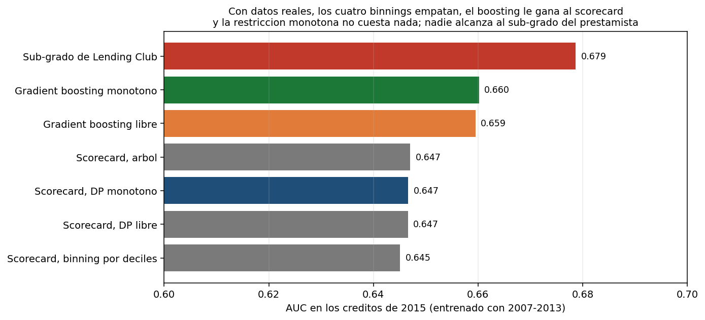
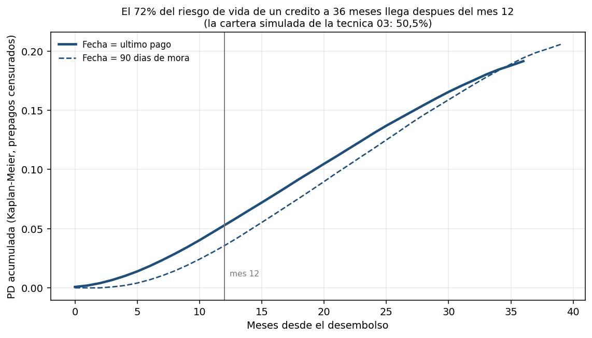
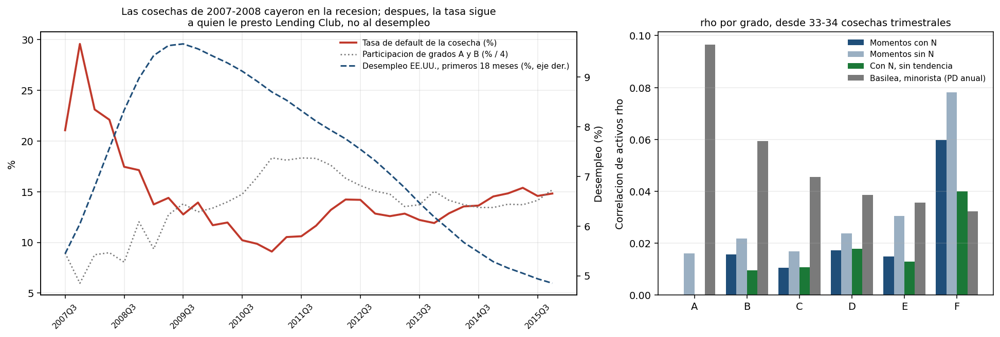
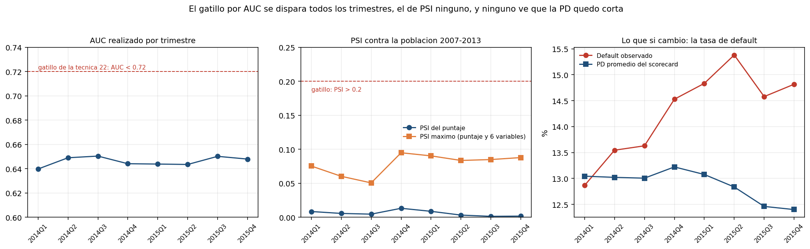

<div align="center">

# 🏦 The Lab's Claims on a Real Loan Book

**Techniques 01, 03, 05, 06, 10, 12 and 22 were built and measured on simulated portfolios. This folder runs their own code on 621,022 real Lending Club loans (2007-2015) and reports which findings survive, which shrink, and which reverse.**

🌐 **[English](README.md)** | **[Español](README.es.md)**

[](https://www.python.org/)
[](#the-data)
[](tests/)
[](../LICENSE)

</div>

---

## Why this folder exists

Most of this lab runs on simulated data for a stated reason: its claims are
about *recovering* something (a coefficient, a correlation, a gap that was
planted), and that can only be checked against a truth you wrote down first.
But several claims are not recoveries. "The scorecard won on accuracy",
"the monotonic constraint costs nothing", "half the book goes to manual
review", "half of lifetime risk arrives after month 12", "PSI catches the
shift": these can be checked on a real book, where nobody controls the
generating process.

Nothing is re-implemented here. [`src/lab.py`](src/lab.py) imports the
optimal binner and scorecard from technique 06, the monotonicity audit and
the conformal predictor from 05, Kaplan-Meier from 03, the correlation
estimators from 10 and the PSI from 12, and this folder only supplies the data
and the comparisons.

Preparing this folder also turned up a bug in technique 10: its method of
moments ignored the binomial noise of finite cohorts, which matters for a real
book whose 2007 cohorts hold a few dozen loans. That is fixed in technique 10
itself (see its granularity section), and the corrected estimator is the one
used below.

## The data

- **Lending Club**, every loan the platform issued through 2018Q4 (Kaggle
  `wordsforthewise/lending-club`, `accepted_2007_to_2018Q4.csv.gz`). Kept:
  36-month loans issued from 2007 to 2015, the ones that have all reached
  maturity in the file, so their outcome is known. That leaves **621,022
  loans** (147 still open were dropped), with **13.95%** charged off.
- **US unemployment rate**, FRED series `UNRATE`, for the vintage analysis.
- **Out of time**: models are fitted on 2007-2013 (175,426 loans, 12.6% bad),
  checked on 2014 (162,570, 13.7%) and tested on 2015 (283,026, 14.9%).
- **Features**: only what was known when the loan was approved: FICO, income,
  debt-to-income, revolving utilisation and balance, inquiries, delinquencies,
  public records, account counts, credit history length, loan size relative
  to income, home ownership, purpose, employment length and income
  verification. Lending Club's own grade, sub-grade and interest rate are kept
  out of every model and used as a benchmark: they are what the lender priced
  with. Nothing recorded after origination is read, except the last payment
  date, which only the default-timing analysis uses.

## What survived

| Claim in the lab | Technique | Simulated | Real (Lending Club) | Verdict |
|---|---|---|---|---|
| Optimal binning recovers more IV than deciles | 06 | +13% | **+6.5%** | holds, smaller |
| A greedy tree edges the DP out of time | 06 | +0.7 pp AUC | **+0.03 pp** | shrinks to noise |
| The interpretable scorecard wins on accuracy | 01 | 0.733 vs. 0.709-0.716 | **0.647 vs. 0.660** | reverses |
| The monotonic constraint costs nothing | 05 | 0.7695 vs. 0.7655 | **0.6602 vs. 0.6595** | holds |
| Unconstrained boosting breaks monotonicity | 05 | 97.15% of applicants | **90.5%** | holds |
| Conformal review volume at α = 0.10 | 05 | 50.1% | **63.7%** | worse |
| Conformal coverage holds | 05 | ≥ 90% | **90.4%**, calibrated a year earlier | holds |
| Lifetime risk arriving after month 12 | 03 | 50.5% | **72.4%** | larger |
| Asset correlation of a rating grade | 10 | 0.12-0.24 (set at Basel's corporate formula) | **0.00-0.06** | far smaller |
| Drift monitoring catches what matters | 12, 22 | PSI 0.82 on the shifted variable | **max PSI 0.095; the AUC trigger fires every quarter** | misses the real change |

The pattern is the same as in the rest of this portfolio: on real data the
signal is weaker (the total Information Value of the scorecard is 0.50,
against 2.12 in technique 06), so differences between methods shrink, and the
thresholds and parameters chosen on simulated data stop meaning what they
meant there.

## 1 · Binning and model choice (techniques 01, 05, 06)



| Model, fitted on 2007-2013 | AUC 2015 | KS 2015 | Brier 2015 | Monotonicity violations |
|---|---|---|---|---|
| Scorecard, equal-frequency bins | 0.6451 | | | 3 non-monotone variables |
| Scorecard, free DP bins | 0.6466 | | | 2 non-monotone variables |
| **Scorecard, monotone DP bins** | 0.6467 | 0.211 | 0.1230 | none |
| Scorecard, tree bins | 0.6470 | | | 4 non-monotone variables |
| Gradient boosting, unconstrained | 0.6595 | 0.230 | 0.1221 | 90.5% of applicants |
| **Gradient boosting, monotonic** | **0.6602** | **0.232** | 0.1221 | **0%** |
| Lending Club's sub-grade (benchmark) | *0.6787* | *0.262* | | |

- **The four binning methods are within 0.2 points of AUC.** The DP still
  finds more Information Value than deciles (0.504 against 0.473) and is still
  the only method with no non-monotone variable, so its argument in technique
  06 (a card a committee can defend) survives. The accuracy argument does not
  separate the methods on this book.
- **The scorecard does not win.** Technique 01's scorecard beat every machine
  learning model on its simulated book; here gradient boosting is 1.3 points
  of AUC ahead, with the same variables.
- **The monotonic constraint is still free.** Technique 05's central claim holds
  on real data: the constrained model is as good as the free one (0.6602
  against 0.6595), and the free one contradicts the expected direction of at
  least one variable for 90.5% of applicants.
- **Lending Club's own grade beats all of them** (0.679). The lender saw the
  full credit report and its own history; these models see 17 summary
  variables. It is the honest ceiling for this exercise, not a target.
- **Every model under-predicts 2015.** Mean PD 12.7-13.0% against 14.9%
  observed: the book got riskier in a way the applicant variables do not show
  (section 5).

## 2 · Conformal decisions (technique 05)

Technique 05's Mondrian conformal predictor, wrapped around the monotonic
model, at α = 0.10:

| | Simulated (05) | Calibrated on 2014, tested on 2015 | Calibrated and tested within 2015 |
|---|---|---|---|
| Coverage (good / bad) | 90% by construction | 90.6% / 89.4% | 90.0% / 90.1% |
| Auto-approved | 32.7% | 25.2% | 24.0% |
| **Manual review** | 50.1% | **63.7%** | 64.2% |
| Auto-declined | — | 11.1% | 11.8% |
| Error rate on automated decisions | 19.8% | 26.4% | 27.9% |
| Bad rate among approved | 7.6% | 6.3% | 6.1% |

The guarantee holds even across a year in which the default rate rose by a
point (coverage of bad loans 89.4%, a hair under 90%). What it costs is
volume: with an AUC of 0.66 the model is unsure about two thirds of the book,
so at α = 0.10 two thirds go to an analyst.

## 3 · When defaults happen (technique 03)



The default date is the month of a charged-off loan's last payment, the start
of the delinquency (Lending Club charges off about five months later).
Technique 03's Kaplan-Meier, with early repayments as censoring:

- PD at 12 months **5.3%**, over the 36-month life **19.1%**: a **3.6×**
  multiple (2.0× in technique 03), so **72.4%** of lifetime risk arrives after
  month 12 (50.5% simulated). Of the loans that actually defaulted, 64.8% made
  their last payment after month 12; the median is month 16.
- Dating each default at 90 days past due instead moves 82.7% of
  lifetime risk past month 12.
- The share falls with the grade: 80% for A loans, 52% for G loans. Safer
  borrowers default later.

For IFRS 9 this is the important direction: a 12-month PD understates the
lifetime loss of these loans by more than the lab's simulated book suggested.

## 4 · Vintages and asset correlation (technique 10)



Each grade is followed one issue quarter at a time (33-34 quarters for grades
A-E, 17 for F; G has too few loans per quarter and is left out). Technique
10's method of moments turns the spread of each grade's cohort default rates
into an asset correlation.

| Grade | 36-month PD | ρ with cohort size | ρ without it | ρ, linear trend removed | Basel, other retail | Basel, corporate |
|---|---|---|---|---|---|---|
| A | 5.6% | 0.000 | 0.016 | 0.000 | 0.097 | 0.166 |
| B | 12.2% | 0.016 | 0.022 | 0.010 | 0.059 | 0.134 |
| C | 17.1% | 0.011 | 0.017 | 0.011 | 0.046 | 0.126 |
| D | 21.6% | 0.017 | 0.024 | 0.018 | 0.039 | 0.122 |
| E | 24.6% | 0.015 | 0.031 | 0.013 | 0.036 | 0.121 |
| F | 30.5% | 0.060 | 0.078 | 0.040 | 0.032 | 0.120 |

(Basel's formulas are evaluated at the annualised PD, 1 − (1 − PD₃₆)^(1/3).)

- **The correlations are small**: 0.00-0.02 for grades A-E, well under the
  0.03-0.16 Basel assumes for other retail exposures and an order of magnitude
  under the 0.12-0.24 of the corporate formula technique 10 simulates.
- **The cohort size matters on a real book.** Without it, the estimate
  doubles for grade E, and for grade A all of the spread is binomial noise:
  given the cohort sizes, nothing systematic is left.
- **Most of the movement is who Lending Club lent to, not the economy.** The
  2007Q4 cohort defaulted at 29.6% into the recession, but from 2009 on the
  quarterly default rate moves with the share of A and B loans (correlation
  −0.83) and slightly *against* unemployment (−0.29). The one-factor model
  assumes a grade means the same risk every quarter; Lending Club re-drew its
  grades over these years. Removing a linear trend from each grade's series
  barely changes A-E and cuts F from 0.060 to 0.040.

## 5 · Drift monitoring (techniques 12 and 22)



The monotone scorecard fitted on 2007-2013 scores each quarter of 2014 and
2015. Technique 12's PSI against the training population, and technique 22's
retraining rule (realised AUC below 0.72 or PSI above 0.20):

- **The AUC trigger fires in all 8 quarters.** The realised AUC sits between
  0.640 and 0.650 the whole time, the level this model has on this book. The
  0.72 threshold suits the simulated chain, where the Champion's realised AUC
  was 0.775 (technique 21) and the trigger fired at 0.64; here 0.64 is what a
  working model scores.
- **The PSI trigger never fires.** The score's PSI never exceeds 0.013 and no
  watched variable exceeds 0.095: on paper, the 2015 applicants look like the
  2007-2013 ones.
- **Neither sees what changed.** The observed default rate rose from 12.9% to
  15.4% while the scorecard's mean PD stayed near 13% and drifted down: by
  2015Q2 it under-predicts by 2.5 points. That is a change in outcomes for the
  same-looking applicants, which a population-stability index cannot detect
  by construction. Technique 21 reports the predicted default rate next to the
  observed one for exactly this reason; technique 22's rule does not use it,
  and on this book it is the only signal that moved.

## What this does not show

- **Approved loans only.** Lending Club's rejected applications have no
  outcome, so nothing here says how these models would do on the full
  applicant population (technique 09's question).
- **One lender, one country, one period.** 2007-2015 contains one recession,
  at the start; the vintage correlations rest on it and on 33-34 quarters.
- **A lifetime target.** The default flag covers the whole 36 months; the
  simulated techniques mostly use a 12-month flag, so AUCs are comparable in
  direction, not to the decimal.
- **A proxy for the default date.** The last payment date marks the start of
  the delinquency; Lending Club does not publish the charge-off date, and the
  90-day version is an approximation of the regulatory definition.
- **One run.** Gradient boosting uses technique 05's settings and seed
  unchanged; the 0.0007 AUC gap between the free and constrained models is
  within run-to-run noise, which is the point of that row.

## Running it

```bash
# ~375 MB from Kaggle (needs a Kaggle account) and one FRED series, into data/raw (gitignored)
kaggle datasets download wordsforthewise/lending-club -f accepted_2007_to_2018Q4.csv.gz -p data/raw
curl -o data/raw/UNRATE.csv "https://fred.stlouisfed.org/graph/fredgraph.csv?id=UNRATE"

python run_pipeline.py     # about 4 minutes on a laptop CPU
pytest -q                  # 22 tests, no data needed
```

The results are in `outputs/reports/lending_club_results.json`, with the
quarterly tables next to it as CSV.

## Files

| File | What it does |
|---|---|
| [`src/lab.py`](src/lab.py) | Loads techniques 03, 05, 06, 10 and 12 from their folders, so the real book runs through their code |
| [`src/data.py`](src/data.py) | Reads the Lending Club file, keeps resolved 36-month loans, builds origination-time features, splits by year |
| [`src/scoring.py`](src/scoring.py) | Four binnings and their scorecards (06), boosting with and without constraints and the audit (05), conformal decisions (05) |
| [`src/timing.py`](src/timing.py) | Kaplan-Meier default curve and the share of lifetime risk after month 12 (03) |
| [`src/vintages.py`](src/vintages.py) | Grade-by-quarter cohorts, asset correlation with and without cohort size, Basel retail and corporate formulas (10) |
| [`src/stability.py`](src/stability.py) | Quarterly PSI, realised AUC and calibration against technique 22's retraining rule (12, 22) |
| [`src/study.py`](src/study.py) | Runs everything and writes the results |
| [`src/plots.py`](src/plots.py) | The four figures |
